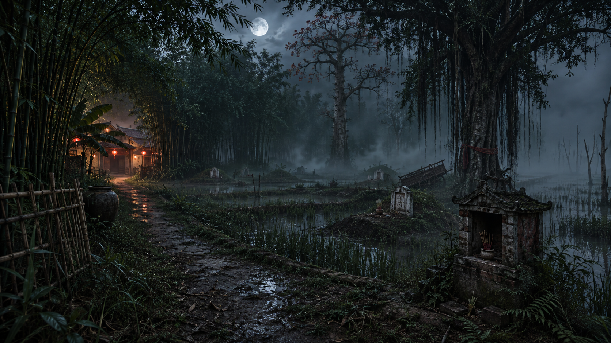

# The forest, and the souls in it (proposal, 2026-11-02, for Catlyn)

**Status:** proposal. Catlyn 2026-11-02: for now only the line "Wandering in the forest won't save you." when
players try to leave by land (built); the souls (§2) are parked. The forest's look and the loop go into the layout (I-14); the wandering souls are
a new threat (I-17) and need Catlyn's go: the brief lists *cô hồn* under non-goals.

## The look (Catlyn's reference, 2026-11-02): `docs/refs/forest_village_edge.png`

One shot of the village's edge looking out: what to build at each gap in the bamboo hedge, and the mood for the
whole forest ring. What's in it, left to right, and how to make it in Roblox:

| In the picture | Build it as |
| --- | --- |
| The bamboo hedge, tall, arching over the path | dense bamboo clumps (one model, reused), 25–35 studs high, leaning in |
| A lattice bamboo fence along the path, a big glazed water jar, a banana plant | parts (fence), store jar (`ASSETS.md`), the banana trees `Build.luau` already has |
| A village house with red lanterns, warm light spilling onto the path | the lane houses; a PointLight per lantern; the only warm light in the frame |
| A muddy wet path with puddles reflecting the light, leaf litter, ferns | Terrain Mud with small water puddles; reflective puddles via Terrain water patches |
| Flooded rice paddies split by earth dikes, reeds | Terrain water in low squares, Ground/Grass dikes on top, reed clumps |
| Grave mounds with small whitewashed headstones, incense at one | parts: an earth mound + a white slab; incense sticks in a bowl (respectful, no names or dates) |
| An overturned ox cart | store model or parts |
| A tall silk-cotton tree (cây gạo), spiky trunk | one hero tree, a landmark seen from the paddies |
| A huge banyan (cây đa), curtains of hanging roots, a red cloth tied round it | the hero tree of the forest edge; roots as thin dark hanging parts or a model |
| A brick roadside shrine (miếu) with a curved tiled roof, incense | the repeating shrine (§1): one model |
| Dead trunks standing in the marsh water on the right | grey cylinders in the marsh by the causeway |
| Full moon behind clouds, low fog lying on the water | the night sky (I-06); Atmosphere + low fog |

**Light and colour:** cold, desaturated blue-grey-green everywhere; the only warm colours are the village's red
lanterns and a few red accents (the banyan's cloth, incense tips). Fog lies low on the water and thickens with
distance. A big full moon: right for the story too, since Rằm (the 15th of the lunar month) is always a full moon.
Starting values to tune in Studio: Atmosphere Density 0.4, Haze 2.5, Color ≈ (120,135,145), Decay ≈ (60,70,75);
ColorCorrection Saturation −0.25 with a cold tint; Bloom on for the lanterns; Sky MoonAngularSize ≈ 15.

**One catch:** the silk-cotton tree's red flowers bloom in spring, not in the seventh lunar month; in game, make it
bare (or almost), which is spookier anyway.

## What Catlyn asked

Exaggerate the forest. Players should feel isolated: they can't escape, they can't find the way they came. Maybe lost
souls in the forest, or something that catches them if they try to leave.

## 1. The forest won't let you leave

- **Bigger and darker than the village.** Tall bamboo and old fig trees with hanging roots, packed close, thick ground
  fog, no lantern light. Twenty steps in, the village lights are gone behind you, and the crickets stop.
- **No way back.** The causeway you came in on runs out into marsh fog and is under water after Night 1. Footpaths
  lead into the trees and branch; none of them goes anywhere.
- **It loops instead of walls.** Go deep enough and, where the fog is thickest and nobody can see, you're moved to a
  matching point on the far side of the ring, still walking forward. You come out of the trees... at the village
  again, from somewhere else. No fade, no message, no invisible wall: just "we were walking away, how are we back?".
  (Replaces today's boundary fade.)
- **Things repeat.** A small roadside altar for wandering souls (bowls of rice porridge, salt, incense, as people set
  out on Rằm tháng bảy) stands by the path. Walk on, and there it is again. And again. Each time a little more of the
  food is gone.

## 2. The wandering souls (cô hồn)

From the story (story.md §2): on the fifteenth of the seventh month *the gates open, and the dead who have no grave
and nobody left to burn incense for them are let out to wander*. The village made its lanterns for them, "for
strangers, souls we had never met". The design docs already name them (threats.md: *hungry ghosts wander the paths
during ghost month and snatch what you carry; rice and salt keep them off*).

- **Where:** only in the forest, beyond the village's lantern light. Never in the village, never by the lake (that is
  Sen's).
- **What you see:** thin, pale, faceless figures standing still between the trees, at the edge of the fog or the edge
  of your eye. They're never there when you look straight at them. Through the camcorder there are more of them, and
  closer.
- **What they do:** they follow you deeper in. The further you go, the more of them, the closer they stand, the quieter
  it gets. If they reach you, they don't take you (that's Sen): they **lead you astray**. The screen goes grey, you
  hear many people whispering, and you come to at the forest's edge facing the village, and something you carried is
  gone (an incense stick, a lantern, camera battery). Never the letter.
- **The counter: rice and salt.** As on Rằm, scatter a handful on the path and they stop to eat; you get a few
  seconds to walk on. A bowl of rice and salt sits at the communal house altar; take a small pouch (three handfuls).
- **Why it helps the game:** it makes "can we just leave?" a real attempt with a real answer, it gives the forest its
  own fear (many, quiet, hungry) different from the lake's (one child, lonely, reaching), and it ties to the heart of
  the story: the village made lanterns for strangers and never one for the child next door.

## What it needs

- I-14: the forest ring, the loop, the repeating roadside altar.
- I-17 (if Catlyn says go): the souls (spawn in the forest only, peripheral visibility, more on camera, follow, "led
  astray" + an item taken), the rice-and-salt pouch and the communal house bowl, the whisper sound, 2 or 3 text lines
  (DRAFT for Catlyn).
- Lifts one non-goal from the brief (§2: "Hungry ghosts (cô hồn), rice and salt").
