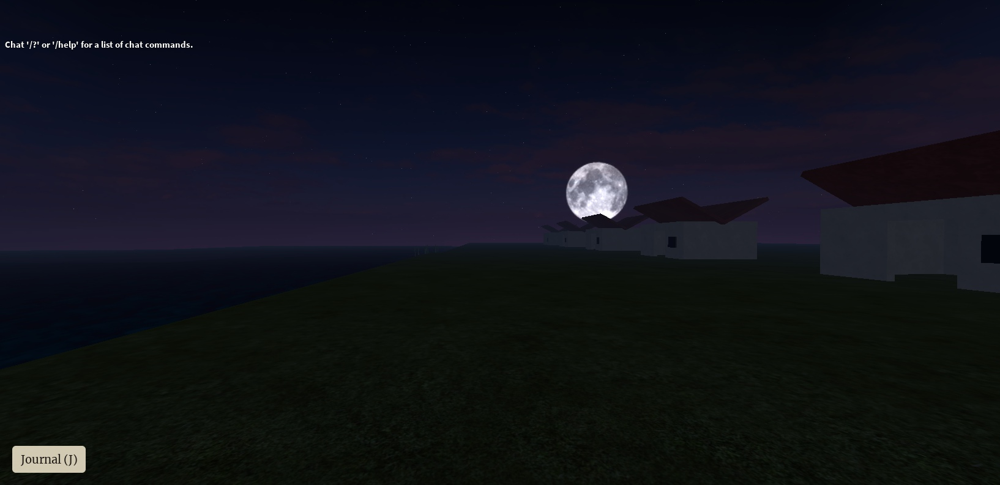
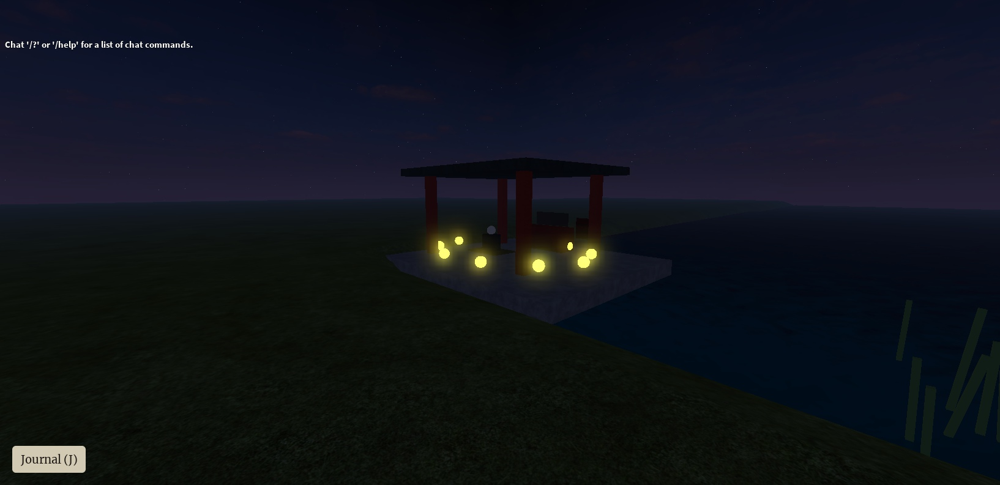
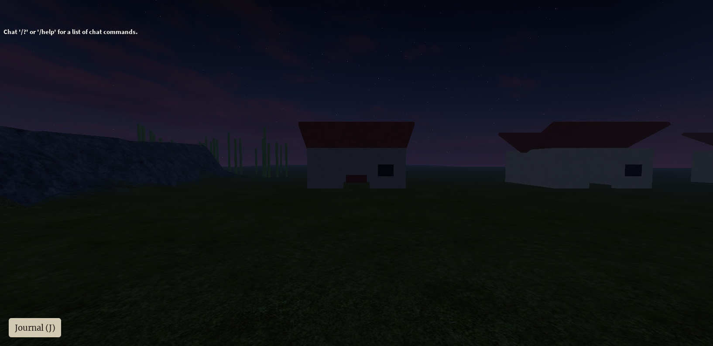
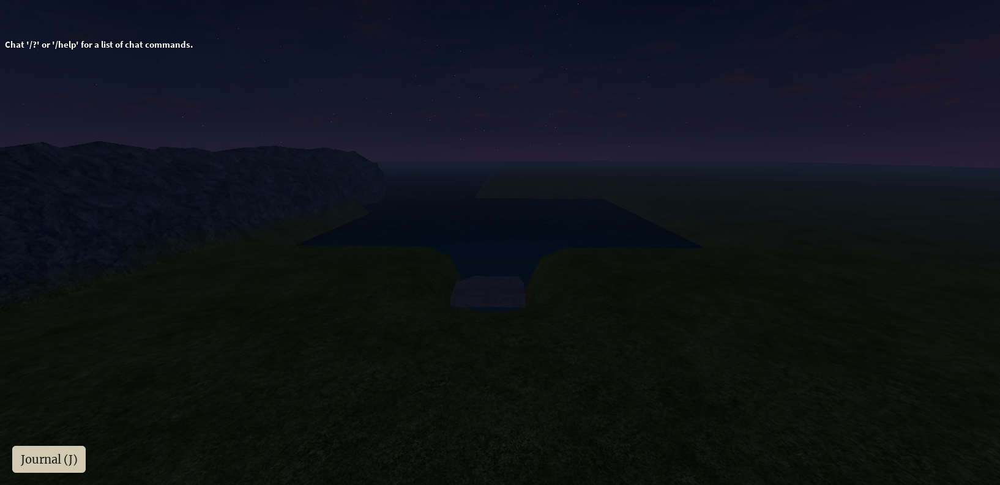
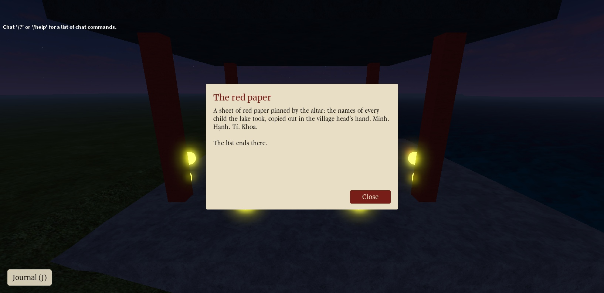
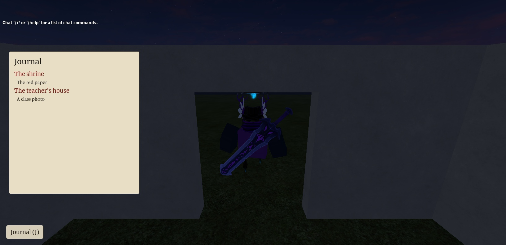
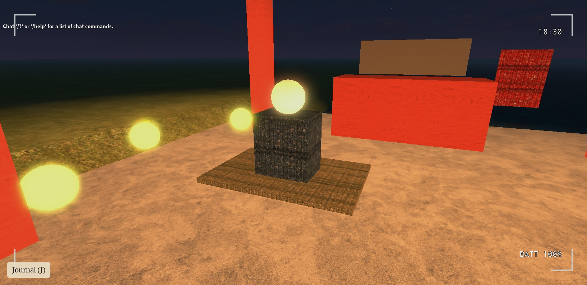
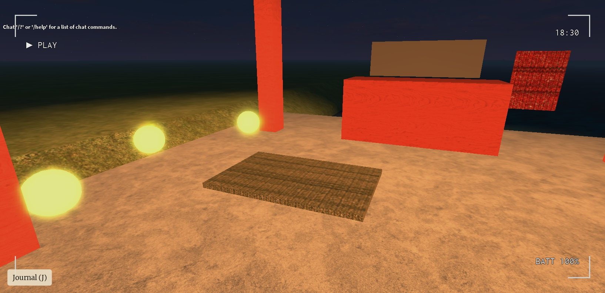
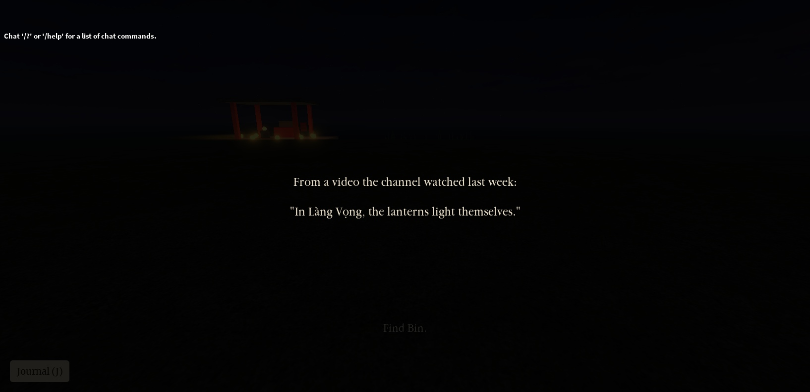

# Làng Vọng test report 20261102-190830

- Commit: `5440a30` + uncommitted changes
- Result: **PASS** — 5 tests passed, 0 failed, 0 console errors

| Test | Section | Status | Detail |
|---|---|---|---|
| 01_boot | Server | ✅ | server started, world built, phase Intro |
| 01_boot | Client | ✅ | client started, UI built |
| 02_world | Server | ✅ | 12 places tagged; lanterns stops, windows, water edges, boundaries ok |
| 02_world | Server | ✅ | walkable from the spawn: CarpSteps 638, Causeway 34, CommunalHouse 39, Dock 166, FishHouse 148, HeadHouse 93, PuppetHouse 203, SenHouse 533, Shrine 94, TeacherHouse 258, TellerHouse 368 |
| 02_world | Server | ✅ | returned to the shore in 0.4 s |
| 02_world | Client | ✅ | card cleared |
| 03_clues | Server | ✅ | 2 clues have a Look prompt; red paper found |
| 03_clues | Client | ✅ | panel shows the red paper; journal lists it under the shrine |
| 03_clues | Server | ✅ | class photo found: shrine_redpaper, teacher_classphoto |
| 03_clues | Client | ✅ |  |
| 03_clues | Client | ✅ | journal shows both, grouped by place |
| 04_camcorder | Server | ✅ | at the shrine, facing Bà Thu |
| 04_camcorder | Client | ✅ | eyes: no footprints, Bà Thu there; viewfinder: both; recorded a 2 s clip |
| 04_camcorder | Client | ✅ | playback: Bà Thu gone, footprints shown |
| 04_camcorder | Client | ✅ | playback ended and restored the world; clips capped at 3 |
| 04_camcorder | Server | ✅ | at the dock, battery 50 |
| 04_camcorder | Client | ✅ | viewfinder up 3 s |
| 04_camcorder | Server | ✅ | battery 50 -> 49.0 with the viewfinder up; 59.4 after 2 s at the shrine |
| 05_phases | Server | ✅ | shrine -> Night1; Open at 21:00; midnight -> Finale |
| 05_phases | Client | ✅ | message line: Find Bin. |
| 05_phases | Server | ✅ | reset: Intro, no clues, full battery |
| 05_phases | Client | ✅ | intro card: From a video the channel watched last week:  "In Làng Vọn |

## Screenshots

