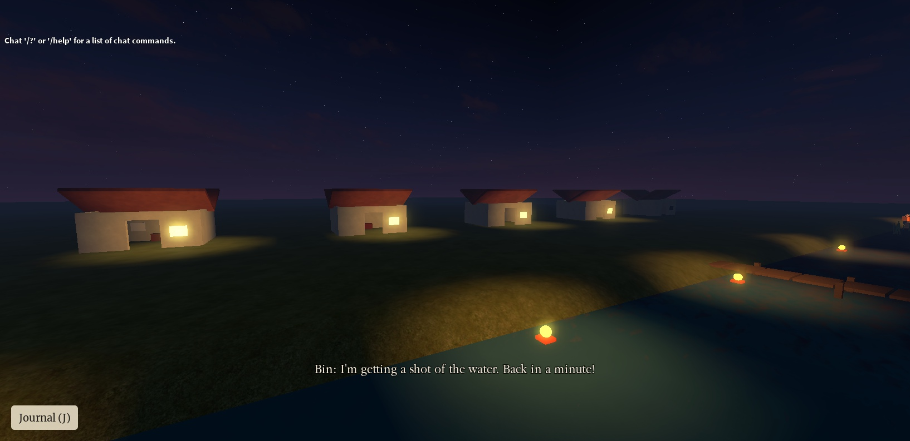
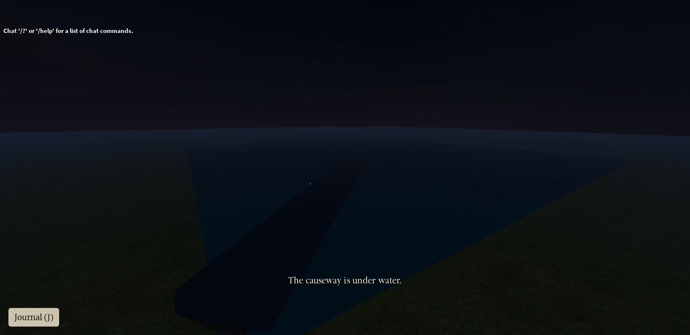
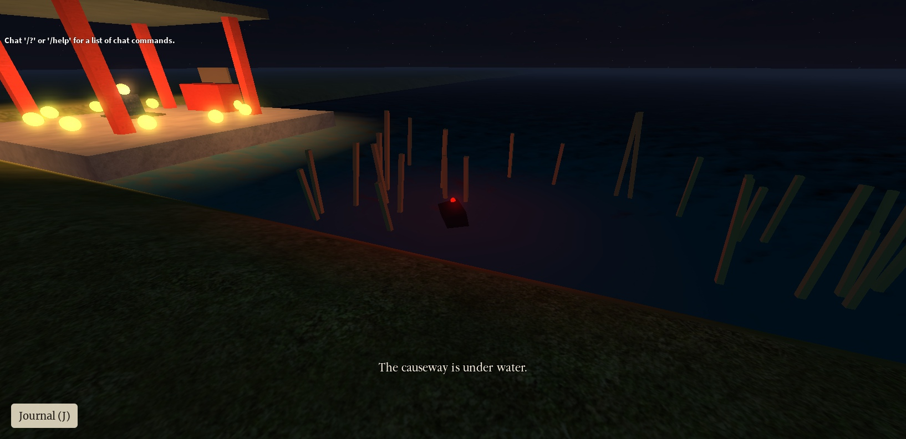
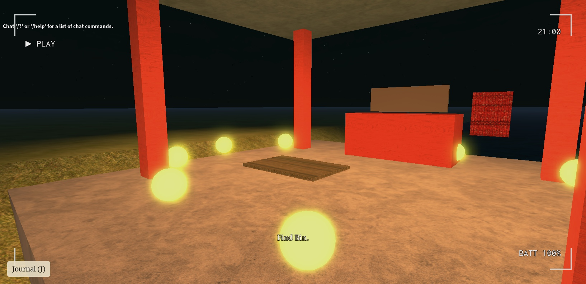
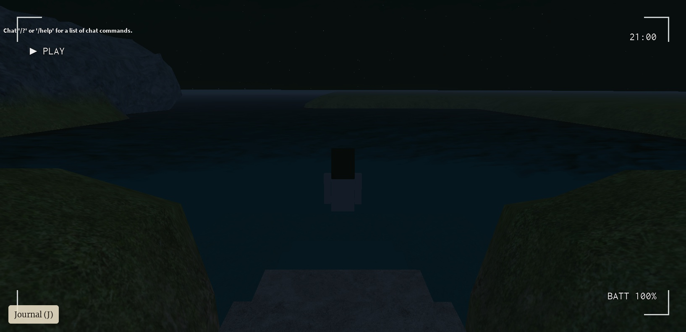
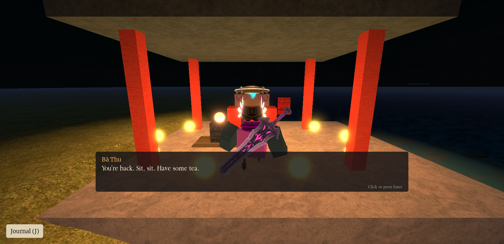

# Làng Vọng test report 20261102-214413

- Commit: `34e16e6` + uncommitted changes
- Result: **FAIL** — 0 tests passed, 1 failed, 0 console errors

| Test | Section | Status | Detail |
|---|---|---|---|
| 06_night1 | Server | ✅ | beat 1 with Bin following; shrine -> beat 2 (Bà Thu's scene) -> beat 3 in 5.7 s |
| 06_night1 | Server | ✅ | four lanterns arrived; lit: FishHouse, HeadHouse, PuppetHouse, TeacherHouse; Sen's house dark |
| 06_night1 | Server | ✅ | Bin gone, causeway flooded (back to the shore in 0.6 s), camera in the reeds |
| 06_night1 | Server | ✅ | picked up Bin's camera -> Open at 21:00 with the tapes; console has [Night1] beat 1..7 |
| 06_night1 | Client | ✅ | chooser: Tape1,Tape2; tape 1 plays and Bà Thu isn't on it |
| 06_night1 | Client | ✅ | tape 2: down the steps; the girl stands in the water |
| 06_night1 | Client | ✅ | tape 2 ends in static; the girl is gone with it; Bà Thu back |
| 06_night1 | Server | ✅ | talking to Bà Thu again (Open phase) |
| 06_night1 | Client | ✅ | dialogue: Bà Thu: You're back. Sit, sit. Have some tea. |
| 06_night1 | Server | ❌ | no second lantern drift at 23:00 |

## Screenshots

