# Làng Vọng test report 20261102-225826

- Commit: `2656c5d` + uncommitted changes
- Result: **FAIL** — 8 tests passed, 1 failed, 0 console errors

| Test | Section | Status | Detail |
|---|---|---|---|
| 01_boot | Server | ✅ | server started, world built, phase Intro |
| 01_boot | Client | ✅ | client started, UI built |
| 02_world | Server | ✅ | 12 places tagged; lanterns stops, windows, water edges, boundaries ok |
| 02_world | Server | ✅ | walkable from the spawn: CarpSteps 638, Causeway 34, CommunalHouse 39, Dock 166, FishHouse 148, HeadHouse 93, PuppetHouse 203, SenHouse 533, Shrine 94, TeacherHouse 258, TellerHouse 368 |
| 02_world | Server | ✅ | returned to the shore in 0.6 s |
| 02_world | Client | ✅ | card cleared |
| 03_clues | Server | ✅ | 14 clues have a Look prompt; red paper found |
| 03_clues | Client | ✅ | panel shows the red paper; journal lists it under the shrine |
| 03_clues | Server | ✅ | class photo found: shrine_redpaper, teacher_classphoto |
| 03_clues | Client | ✅ |  |
| 03_clues | Client | ✅ | journal shows both, grouped by place |
| 04_camcorder | Server | ✅ | at the shrine, facing Bà Thu |
| 04_camcorder | Client | ✅ | eyes: no footprints, Bà Thu there; viewfinder: both; recorded a 2 s clip |
| 04_camcorder | Client | ✅ | playback: Bà Thu gone, footprints shown |
| 04_camcorder | Client | ✅ | playback ended and restored the world; clips capped at 3 |
| 04_camcorder | Server | ✅ | at the dock, battery 50 |
| 04_camcorder | Client | ✅ | viewfinder up 3 s |
| 04_camcorder | Server | ✅ | battery 50 -> 49.0 with the viewfinder up; 59.5 after 2 s at the shrine |
| 05_phases | Server | ✅ | shrine -> Night1; Open at 21:00; midnight -> Finale |
| 05_phases | Client | ✅ | message line: Find Bin. |
| 05_phases | Server | ✅ | reset: Intro, no clues, full battery |
| 05_phases | Client | ✅ | intro card: From a video the channel watched last week:  "In Làng Vọn |
| 06_night1 | Server | ✅ | beat 1 with Bin following; shrine -> beat 2 (Bà Thu's scene) -> beat 3 in 5.6 s |
| 06_night1 | Server | ✅ | four lanterns arrived; lit: FishHouse, HeadHouse, PuppetHouse, TeacherHouse; Sen's house dark |
| 06_night1 | Server | ✅ | Bin gone, causeway flooded (back to the shore in 0.4 s), camera in the reeds |
| 06_night1 | Server | ✅ | picked up Bin's camera -> Open at 21:00 with the tapes; console has [Night1] beat 1..7 |
| 06_night1 | Client | ✅ | chooser: Clip1,Clip2,Clip3,Tape1,Tape2; tape 1 plays and Bà Thu isn't on it |
| 06_night1 | Client | ✅ | tape 2: down the steps; the girl stands in the water |
| 06_night1 | Client | ✅ | tape 2 ends in static; the girl is gone with it; Bà Thu back |
| 06_night1 | Server | ✅ | talking to Bà Thu again (Open phase) |
| 06_night1 | Client | ✅ | dialogue: Bà Thu: You're back. Sit, sit. Have some tea. |
| 06_night1 | Server | ✅ | 23:00: the lanterns go out again; reset clears flood, camera, tapes and windows |
| 07_mystery | Server | ✅ | 14 clues placed, each with a Look prompt; 4 mementos; the altar prompt |
| 07_mystery | Client | ✅ | memory: Minh, eleven. The teacher's son. Glasses, and afraid of disappointing his father. |
| 07_mystery | Client | ✅ | the memory faded back |
| 07_mystery | Server | ✅ | every clue readable into the journal (15); the letter taken from under the altar |
| 07_mystery | Client | ✅ | letter: A letter from the city, folded up very small and hidden under the altar, under the ancesto |
| 07_mystery | Client | ✅ | panel closed |
| 07_mystery | Server | ✅ | stuck hint fired at Shrine |
| 07_mystery | Server | ❌ | no carp at the steps |
| 08_sen | Server | ✅ | warnings 1-5 in order, then taken to the drowned festival; the letter dropped where they stood |
| 08_sen | Client | ✅ | taken: the lantern button is up; lit a lantern |
| 08_sen | Server | ✅ | the lantern flickered near a clue; incense at the shrine brought them back; the shrine is safe |
| 08_sen | Client | ✅ | back: the lantern button is gone |
| 08_sen | Server | ✅ | incense: she withdraws (1 left); walking away from the water cancels her |
| 08_sen | Server | ✅ | second taking for good -> everyone taken -> Im lặng; summary printed; reset brings everyone back |
| 09_endings | Server | ✅ | the letter given; she asks for the name |
| 09_endings | Client | ✅ | dialogue: Write her name on it for me. [Write: Sen] |
| 09_endings | Server | ✅ | Write: Sen -> she walked to the bottom step (10 s at 25x) -> Về nhà finale |
| 09_endings | Server | ✅ | Về nhà: Sen and the children rise, Bà Thu takes her hand, dawn, Bin asleep on the bank; summary printed |
| 09_endings | Client | ✅ | card: That was all Sen ever wanted, I think. Someone to say her name and hold on to he |
| 09_endings | Server | ✅ | midnight at the carp steps |
| 09_endings | Client | ✅ | choice: Sen is reaching for your hand. |
| 09_endings | Client | ✅ | held on |
| 09_endings | Server | ✅ | Ở lại: held on -> stayed with Sen; Bin goes free |
| 09_endings | Server | ✅ | Im lặng: every lantern went out |
| 09_endings | Client | ✅ | static and the Im lặng card |
| 09_endings | Server | ✅ | reset: lanterns lit again, Bà Thu back on her mat, no ending |
| 09_endings | Client | ✅ | camera and screen back to normal |

## Screenshots

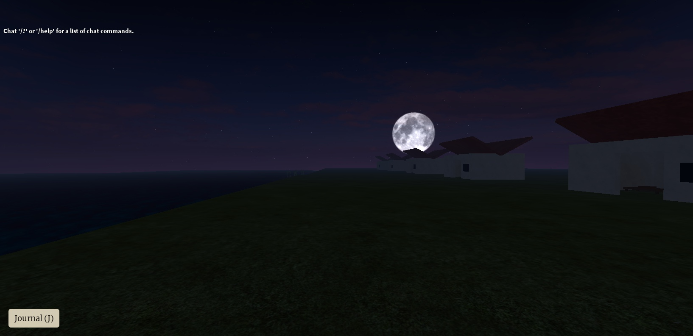
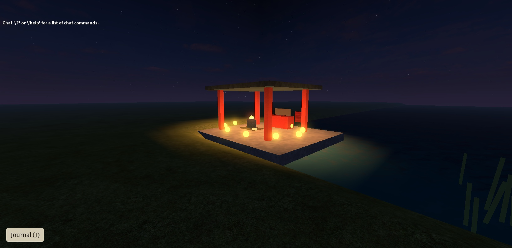
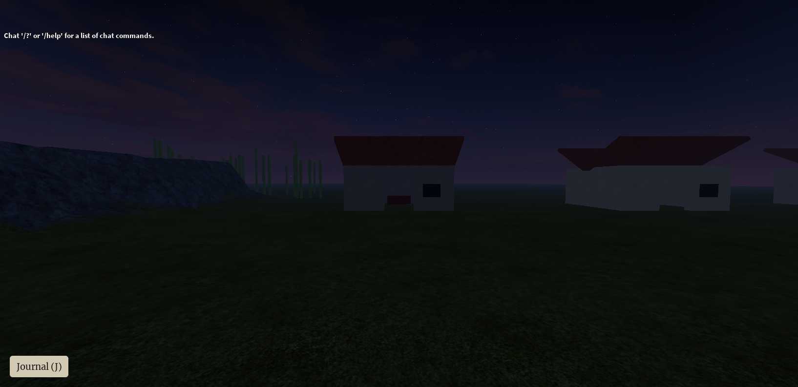
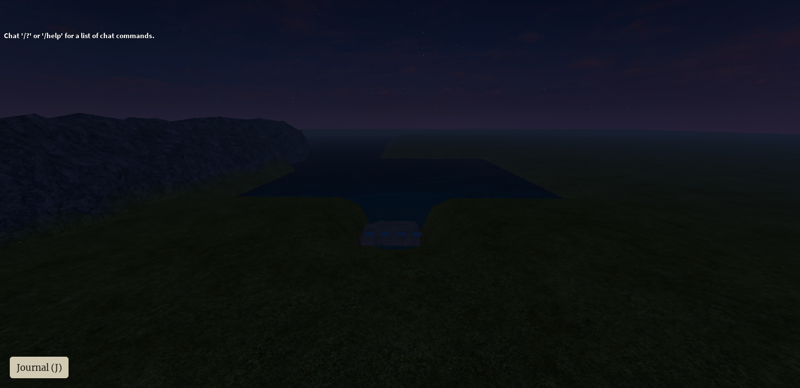
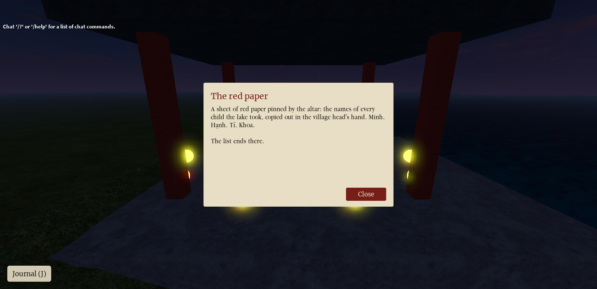
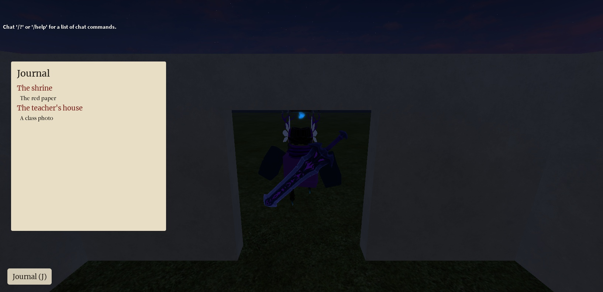
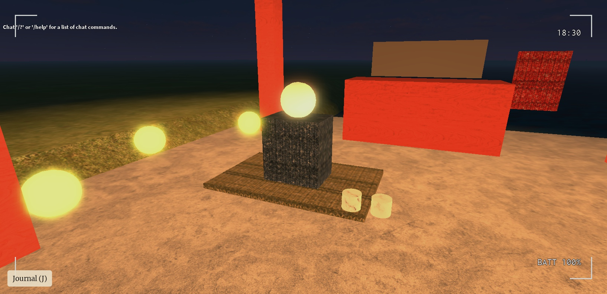
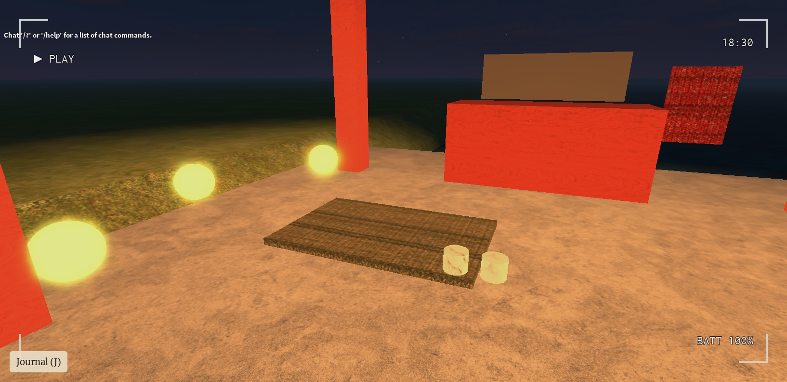
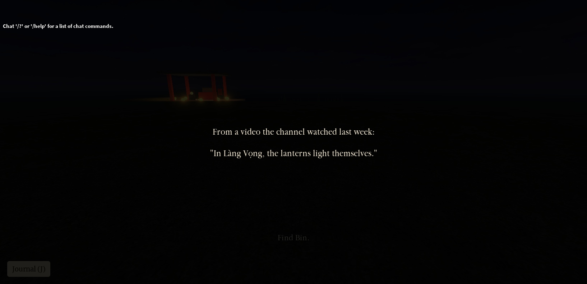
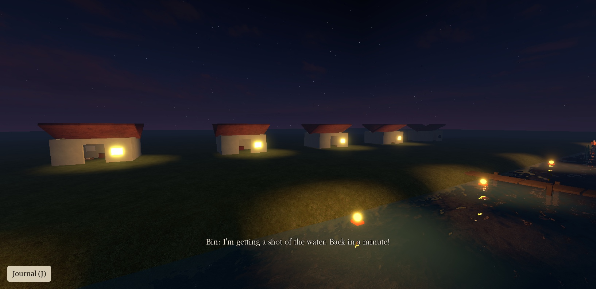
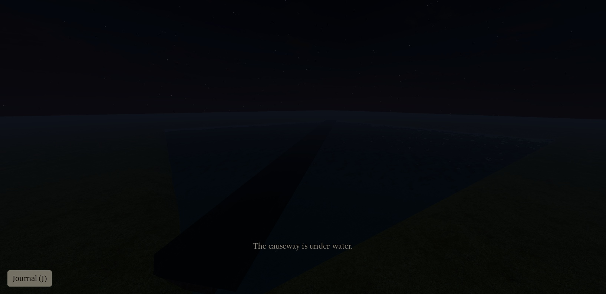
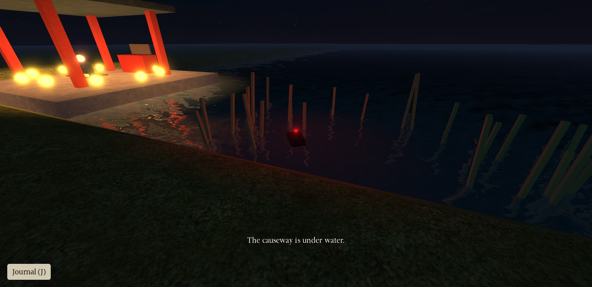
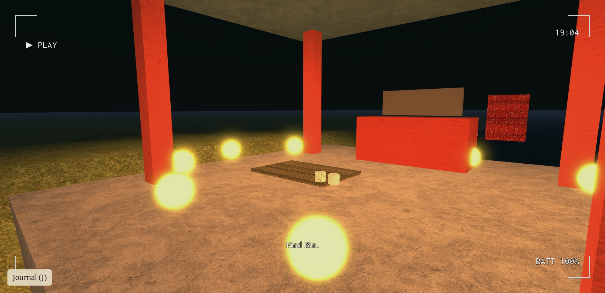
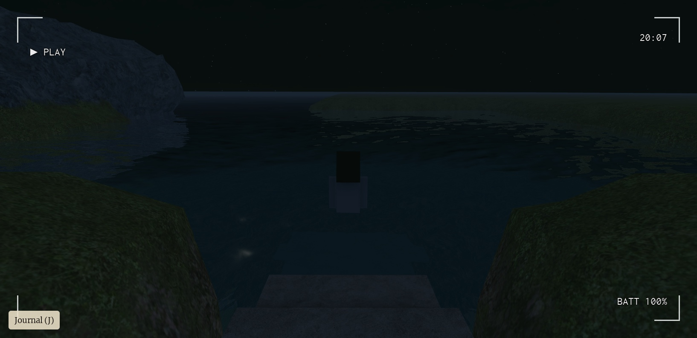
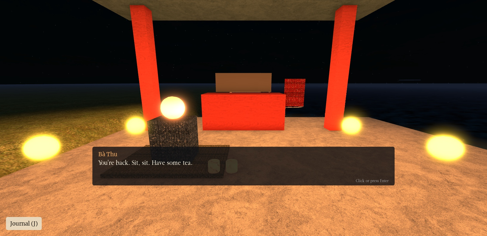
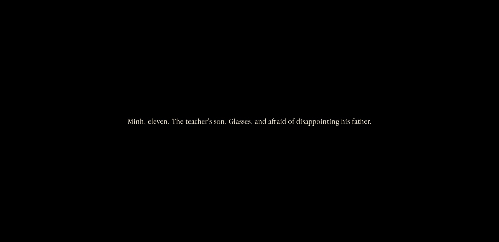
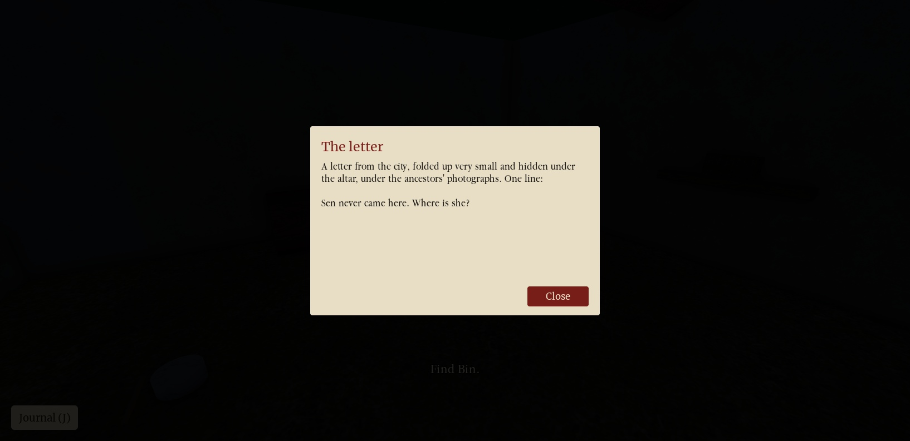
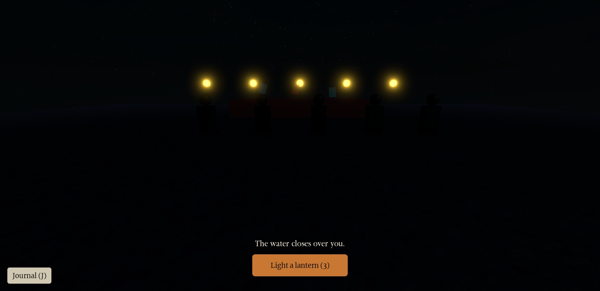
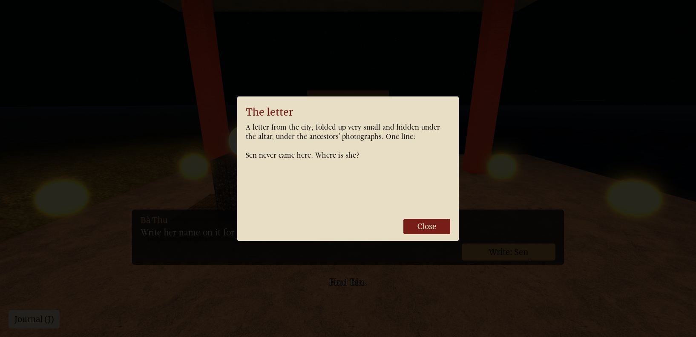
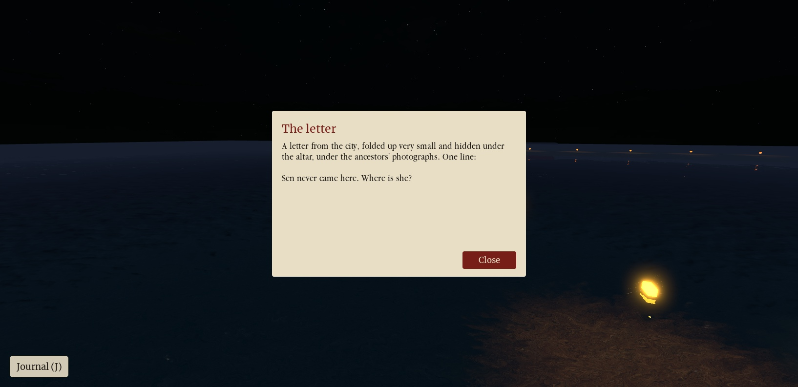

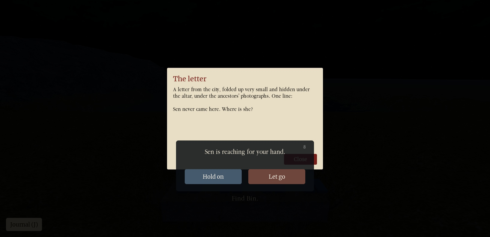

