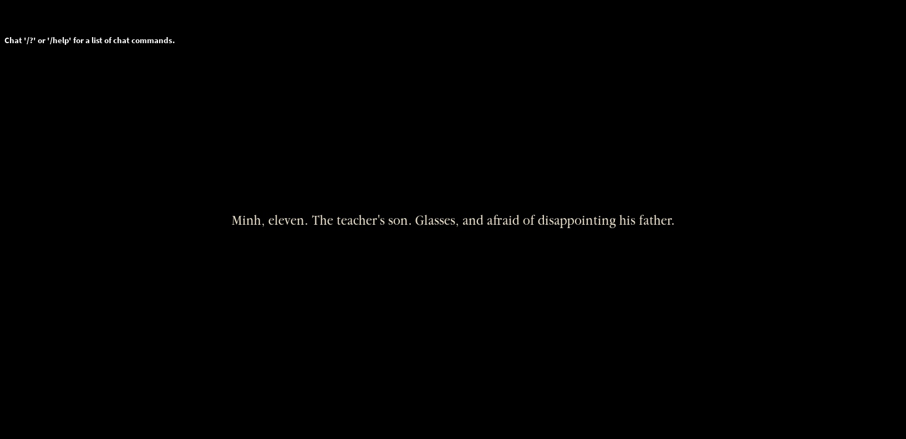
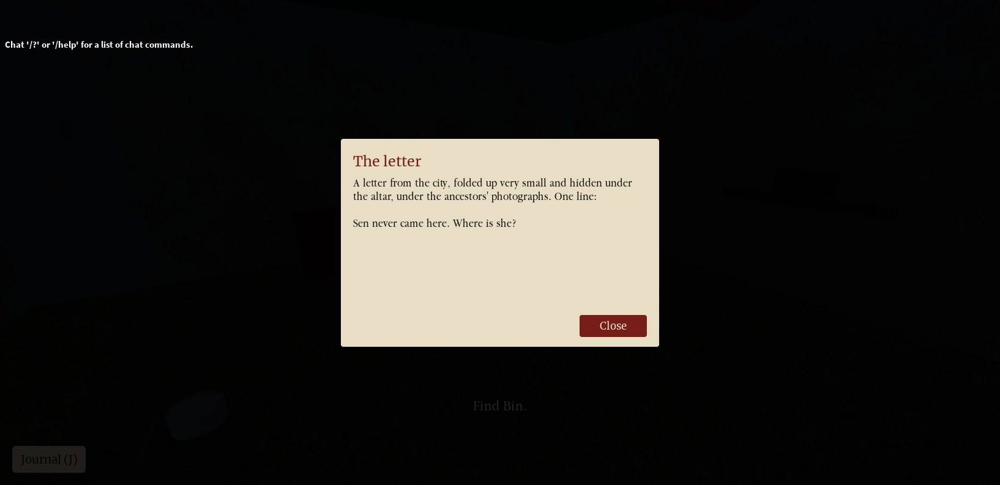
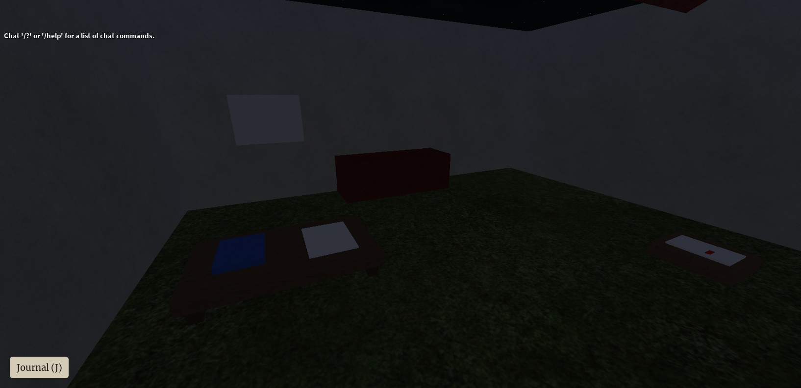

# Làng Vọng test report 20261102-230106

- Commit: `2656c5d` + uncommitted changes
- Result: **PASS** — 1 tests passed, 0 failed, 0 console errors

| Test | Section | Status | Detail |
|---|---|---|---|
| 07_mystery | Server | ✅ | 14 clues placed, each with a Look prompt; 4 mementos; the altar prompt |
| 07_mystery | Client | ✅ | memory: Minh, eleven. The teacher's son. Glasses, and afraid of disappointing his father. |
| 07_mystery | Client | ✅ | the memory faded back |
| 07_mystery | Server | ✅ | every clue readable into the journal (15); the letter taken from under the altar |
| 07_mystery | Client | ✅ | letter: A letter from the city, folded up very small and hidden under the altar, under the ancesto |
| 07_mystery | Client | ✅ | panel closed |
| 07_mystery | Server | ✅ | stuck hint fired at SenHouse |
| 07_mystery | Server | ✅ | carp rise when someone climbs down the steps |
| 07_mystery | Server | ✅ | reset clears the letter |

## Screenshots

